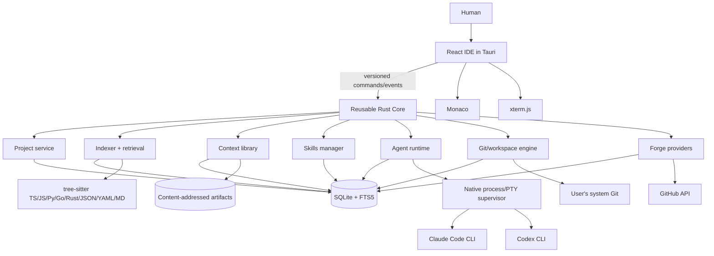
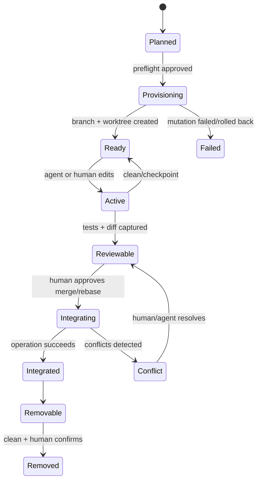

# Mars Architecture

Status: MVP implementation in progress; Proofs A–E implemented, deterministic F path implemented; Phase 0 indexing and Phase 1 Project Brain implemented
Last updated: 2026-09-08

## 1. Concrete MVP restatement

Mars is a local-first desktop IDE in which a human can open a real TypeScript/JavaScript Git repository, browse and edit it, use a native terminal, index its structure, create an isolated task worktree, and run Claude Code or Codex there. The same task can retain text/image context, selected skills, decisions, diffs, and test evidence so a second agent can review the first without manual copy/paste. GitHub issues can become tasks and completed work can become pull requests whose checks and reviews remain visible in the IDE.

The MVP is proven only by six running vertical slices:

| Proof | User-visible outcome |
| --- | --- |
| A | Open repository → browse/edit → index TS/JS → query Project Brain |
| B | Create task → create branch/worktree → run real agent → stream normalized output |
| C | Capture text/image + install skill → retrieve both → use in agent work |
| D | Complete work → extract reviewable memory → answer “why?” with provenance |
| E | Claude implements → Codex reviews exact diff with shared compact context |
| F | GitHub issue → task/worktree → pull request → checks/reviews in IDE |

Proof A is implemented. A trusted Git repository can be browsed and edited through repository-scoped native services, used as the working directory of a native PTY, incrementally indexed into a tree-sitter/SQLite graph, and queried through bounded evidence-backed Project Brain tools. The React workspace composes the shadcn/ui Explorer and Brain surfaces with Monaco source navigation and xterm rendering.

Proof B is implemented. Tasks begin as mutation-free branch/worktree plans, require approval before system-Git provisioning, and open their isolated roots in the same Explorer, Monaco, and terminal workspace. Claude Code and Codex adapters probe installed versions, build bounded commands without permission-bypass flags, normalize streaming JSONL, retain unknown frames, and support provider checkpoints for follow-up runs. A durable process supervisor records redacted ordered events, handles bounded delivery, cancellation escalation, exit state, and restart interruption. The Tasks-first shadcn/ui flow exposes capability grants and retains only the newest 500 rendered events while the durable native history remains authoritative. The real Milestone B proof used Codex in a disposable Mars-managed worktree and is recorded in `docs/proofs/b-agent-worktree.md`.

Proof C is implemented. Context capture preserves exact text/image originals in a content-addressed store, deduplicates by SHA-256, attaches safe items to tasks, and quarantines detected secrets. Skills are discovered from skills.sh through a replaceable registry, inspected before trust, locally rehashed, pinned, atomically installed, scoped, and adapter-filtered. Deterministic retrieval combines explicit attachments, active constraints, context/knowledge FTS, exact symbols, one-hop graph neighbors, read-only Git recency, active work, and relevant trusted skills. Every included item carries provenance, freshness, source location, score, and reason; hard exclusions remain visible. A shadcn/ui preview exposes the exact byte-budgeted pack with remove/re-add controls before permissions. Launch rebuilds and compares the preview server-side, rejects stale/tampered packs, then delivers it through the existing real adapter path. The live Codex proof is recorded in `docs/proofs/c-context-skills.md`.

Proof D is implemented. Completed normalized sessions, exact Git diffs, task intent, and diff-overlapping indexed symbols form a bounded untrusted evidence bundle. A visibly permitted configured model returns only strict evidence-referenced candidates; invalid categories, fields, evidence, entities, confidence, and duplicates fail closed. HUMAN provenance is required to approve, correct/supersede, reject, stale, or pin memory, and correction preserves history plus semantic links. The shadcn/ui review surface keeps candidates visibly untrusted. Bounded “Why?” queries return approved facts separately from inference, surface conflicts/staleness/insufficient evidence, and trace code through knowledge, session/task, clickable diff evidence, and—when published—the exact head commit and normalized hosted PR. The live two-agent-call proof is recorded in `docs/proofs/d-memory-why.md`.

Proof E is implemented. Provider-neutral implementation events persist alongside redacted raw frames. A completed Claude/Codex session can produce a bounded handoff for the other adapter containing the visible task context, concise implementation/test evidence, and exact untruncated diff plus digest. The shadcn/ui review dialog previews that payload; launch reconstructs it server-side and invokes the reviewer read-only. Strict findings must cite real hunk IDs and in-range lines, persist atomically, and can be resolved/dismissed or sent back as an evidence-backed implementer follow-up. Active worktrees are also compared using real diffs plus indexed symbol spans and one-hop graph edges; evidence-bearing overlap warnings degrade visibly when the index is incomplete. The live Claude → Codex proof is recorded in `docs/proofs/e-cross-agent-review.md`.

Proof F has a complete deterministic production path but not a live GitHub gate. Git remotes normalize behind `ForgeProvider`; GitHub credentials are verified against the current-user endpoint, stored in the native OS keychain, and represented in SQLite only by an opaque reference. Issues import idempotently into durable normalized records and explicitly become task plans. PR creation previews and revalidates the exact fetch/push targets, commit, head/base/title/body, and requires separate push and forge approvals. System Git performs the push; the GitHub provider creates or recovers the matching PR, paginates checks/comments, and persists a restart-safe snapshot. Permission decisions and forge attempts are journaled before their effect, abandoned attempts become interrupted on restart, and a confirmed PR identity is saved before secondary check/comment refresh. The shadcn UI exposes bounded task publish history with plan identity and recovery state, polls PR state while open, and can route a hosted review comment back into the agent prompt. The local proof is recorded in `docs/proofs/f-github.md`; a real disposable repository/issue/token is still required for the external-write gate.

Phase 0 rebuilt the index as the substrate every later feature reads from: ten
languages, a complete file layer, chunks with local embeddings, Git history, and
an explicit freshness verdict on every answer. It is recorded in
`docs/proofs/0-repo-indexing.md`.

Phase 1 is implemented. Project Brain answers questions about a repository with
citations, as a structured document rather than prose: claims separated into
facts and inferences that are never merged, citations that resolve back to the
working tree, the source count and latency reported verbatim, and an explicit
list of what could not be determined. `brain.ask`, `brain.explain`,
`brain.whereIsX`, and `brain.dependencies` serve the agent as a tool, the
desktop as an Ask activity streaming claims as their evidence is confirmed, and
a CLI harness. It is recorded in `docs/proofs/1-project-brain.md`.

The editor, terminal, agents, context, graph, and Git lifecycle are one product. The MVP does not include an autonomous swarm, hosted collaboration, organization policy, non-GitHub forge parity, broad language support, or automatic merge.

## 2. Highest-risk assumptions

| Risk | Assumption to prove | Early proof / fallback |
| --- | --- | --- |
| Agent process integration | Claude Code and Codex expose stable-enough machine-readable output, resume, and cancellation semantics | Build transcript fixtures and real CLI smoke tests in Milestone B; preserve raw output and tolerate `Unknown` events |
| Safe unattended isolation | Git worktrees can be created and recovered predictably across common repository states | Preflight dirty/default-branch/path checks; journal every mutation; never auto-delete a non-clean worktree |
| Useful structural indexing | Tree-sitter alone gives valuable TS/JS definitions/imports and conservative call/reference edges | Measure fixture precision in A; label unresolved edges and add TypeScript compiler enrichment only if needed |
| Retrieval quality | A deterministic graph + FTS + recency ranker is sufficient before embeddings | Golden retrieval cases in C; retain rank explanations; embeddings remain an optional reranker |
| Durable “why” memory | Session events + diff can yield concise facts without storing chain-of-thought or hallucinated rationale | Require evidence links, confidence, and human approval; inferred facts never outrank human facts |
| UI performance | Monaco, xterm.js, agent streaming, and indexing coexist without blocking | All machine work lives in Rust jobs; paginated protocol; bounded event batches and backpressure |
| SQLite concurrency | One local database supports index, event, and UI reads | WAL mode, one write coordinator, short transactions, resumable index runs |
| Skills supply chain | skills.sh packages can be safely inspected and pinned | Download to quarantine, inspect manifest/SKILL.md, hash files, require trust activation |
| Forge compatibility | System Git plus GitHub API covers the launch workflow without owning credentials | Detect remotes; OAuth/device flow token in OS keychain; provider interface does not leak GitHub types |
| Cross-agent handoff | A compact normalized pack is more useful than copying full transcripts | E2E budget/coverage assertions and a human-visible “context sent” preview |

## 3. System architecture



### Runtime shape

- `apps/desktop` owns windows, menus, global capture registration, React state, Monaco, and xterm rendering.
- Desktop UI uses Tailwind CSS v4 and local shadcn/ui source components with semantic design tokens. Components begin app-local; only proven cross-app primitives move to `packages/ui`.
- `crates/core` composes domain services and exposes a transport-neutral `CoreApi` plus event subscription. Tauri is one transport; a future local socket is another.
- Domain crates own machine/repository/process lifecycle. They never depend on Tauri or React.
- `packages/protocol` is the versioned command/event contract generated or checked against Rust types.
- SQLite is the authoritative local metadata store. Source files and Git remain authoritative for code/history. Binary artifacts live in a content-addressed directory, with metadata in SQLite. The Rust build bundles a known SQLite version with FTS5 enabled instead of relying on the host SQLite feature set.
- Long-running operations are designed as persisted jobs with cancellation tokens and checkpoints. The Milestone A indexer already publishes transactionally and accepts cancellation, but its desktop command is still synchronous; durable command orchestration lands with the jobs/agent workflow. UI disconnects must not imply process cancellation once that orchestration is wired.

### Dependency rule

```text
desktop -> protocol/shared-types/ui
Tauri adapter -> core
core -> git/agents/indexer/brain/context/skills/forge/security
domain crates -> storage abstractions + protocol types
domain crates -X-> desktop/Tauri/React
```

## 4. Monorepo/package structure

```text
apps/
  desktop/
    src/                     # React routes, features, stores
    src-tauri/               # thin Tauri command/event adapter
crates/
  core/                      # service composition, jobs, CoreApi
  storage/                   # SQLite pool, migrations, repositories
  git/                       # system-git adapter, diff, worktrees
  agents/                    # process supervisor, adapters, handoffs
  indexer/                   # ignore walk, tree-sitter, chunks/embeddings, history, incremental index
  brain/                     # graph queries, retrieval, memory, why
  context/                   # capture metadata and artifact store
  skills/                    # discovery, quarantine, trust, activation
  forge/                     # provider trait and normalized entities
  forge-github/              # GitHub HTTP implementation
  security/                  # permissions, redaction, keychain facade
packages/
  protocol/                  # JSON schema + generated TS/Rust contract tests
  shared-types/              # presentation-safe TypeScript types
  ui/                        # shared shadcn components promoted after real reuse
fixtures/
  repositories/              # tiny deterministic Git/TS fixture repos
  agents/                    # redacted Claude/Codex event streams
docs/
  plans/
  runbooks/
scripts/
  check-protocol.mjs
future/
  cli/
  headless-runner/
ARCHITECTURE.md
DECISIONS.md
```

Use a Cargo workspace and pnpm workspace. Rust tests own process, storage, Git, graph, and adapter behavior; Vitest/Testing Library own UI behavior; Playwright covers the six desktop workflows where automation is practical.

## 5. SQLite data model

Identifiers are application-generated UUIDv7 strings. Timestamps are RFC 3339 UTC text. Booleans are integer `0/1`. Extensible payloads use validated JSON text, but query-critical fields are columns. Every mutable table has `created_at` and `updated_at`; abbreviated below where repetitive.

```sql
PRAGMA foreign_keys = ON;
PRAGMA journal_mode = WAL;

CREATE TABLE projects (
  id TEXT PRIMARY KEY, name TEXT NOT NULL, created_at TEXT NOT NULL, updated_at TEXT NOT NULL
);
CREATE TABLE repositories (
  id TEXT PRIMARY KEY, project_id TEXT NOT NULL REFERENCES projects(id) ON DELETE CASCADE,
  root_path TEXT NOT NULL UNIQUE, git_common_dir TEXT NOT NULL, default_branch TEXT,
  head_oid TEXT, state TEXT NOT NULL CHECK (state IN ('active','missing','untrusted')),
  created_at TEXT NOT NULL, updated_at TEXT NOT NULL
);
CREATE TABLE remotes (
  id TEXT PRIMARY KEY, repository_id TEXT NOT NULL REFERENCES repositories(id) ON DELETE CASCADE,
  name TEXT NOT NULL, fetch_url TEXT NOT NULL, push_url TEXT, provider TEXT,
  owner TEXT, repo_name TEXT, UNIQUE(repository_id, name)
);
CREATE TABLE forge_connections (
  id TEXT PRIMARY KEY, provider TEXT NOT NULL, host TEXT NOT NULL, account_login TEXT,
  keychain_ref TEXT NOT NULL, scopes_json TEXT NOT NULL, created_at TEXT NOT NULL, updated_at TEXT NOT NULL,
  UNIQUE(provider, host, account_login)
);

CREATE TABLE files (
  id TEXT PRIMARY KEY, repository_id TEXT NOT NULL REFERENCES repositories(id) ON DELETE CASCADE,
  relative_path TEXT NOT NULL, language TEXT, content_hash TEXT NOT NULL, byte_size INTEGER NOT NULL,
  mtime_ns INTEGER, indexed_at TEXT, deleted_at TEXT, UNIQUE(repository_id, relative_path)
);
CREATE TABLE symbols (
  id TEXT PRIMARY KEY, file_id TEXT NOT NULL REFERENCES files(id) ON DELETE CASCADE,
  stable_key TEXT NOT NULL, kind TEXT NOT NULL, name TEXT NOT NULL, qualified_name TEXT,
  start_byte INTEGER NOT NULL, end_byte INTEGER NOT NULL, start_line INTEGER NOT NULL, end_line INTEGER NOT NULL,
  signature TEXT, exported INTEGER NOT NULL DEFAULT 0, content_hash TEXT NOT NULL,
  UNIQUE(file_id, stable_key)
);
CREATE TABLE code_edges (
  id TEXT PRIMARY KEY, repository_id TEXT NOT NULL REFERENCES repositories(id) ON DELETE CASCADE,
  source_kind TEXT NOT NULL, source_id TEXT NOT NULL, edge_kind TEXT NOT NULL,
  target_kind TEXT NOT NULL, target_id TEXT, target_key TEXT,
  confidence REAL NOT NULL CHECK(confidence BETWEEN 0 AND 1), evidence_json TEXT NOT NULL,
  index_run_id TEXT REFERENCES index_runs(id), UNIQUE(source_kind, source_id, edge_kind, target_kind, target_id, target_key)
);
CREATE INDEX code_edges_source ON code_edges(source_kind, source_id, edge_kind);
CREATE INDEX code_edges_target ON code_edges(target_kind, target_id, edge_kind);
CREATE TABLE index_runs (
  id TEXT PRIMARY KEY, repository_id TEXT NOT NULL REFERENCES repositories(id) ON DELETE CASCADE,
  base_head_oid TEXT, status TEXT NOT NULL, cursor_json TEXT, files_seen INTEGER NOT NULL DEFAULT 0,
  error TEXT, started_at TEXT NOT NULL, finished_at TEXT
);

CREATE TABLE tasks (
  id TEXT PRIMARY KEY, project_id TEXT NOT NULL REFERENCES projects(id) ON DELETE CASCADE,
  repository_id TEXT REFERENCES repositories(id), parent_task_id TEXT REFERENCES tasks(id),
  title TEXT NOT NULL, intent TEXT NOT NULL, status TEXT NOT NULL,
  priority INTEGER NOT NULL DEFAULT 0, source_issue_id TEXT, created_at TEXT NOT NULL, updated_at TEXT NOT NULL
);
CREATE TABLE task_dependencies (
  task_id TEXT NOT NULL REFERENCES tasks(id) ON DELETE CASCADE,
  depends_on_task_id TEXT NOT NULL REFERENCES tasks(id), kind TEXT NOT NULL,
  PRIMARY KEY(task_id, depends_on_task_id, kind), CHECK(task_id <> depends_on_task_id)
);
CREATE TABLE branches (
  id TEXT PRIMARY KEY, repository_id TEXT NOT NULL REFERENCES repositories(id) ON DELETE CASCADE,
  name TEXT NOT NULL, base_ref TEXT NOT NULL, head_oid TEXT, created_by_task_id TEXT REFERENCES tasks(id),
  state TEXT NOT NULL, UNIQUE(repository_id, name)
);
CREATE TABLE worktrees (
  id TEXT PRIMARY KEY, repository_id TEXT NOT NULL REFERENCES repositories(id) ON DELETE CASCADE,
  task_id TEXT NOT NULL REFERENCES tasks(id), branch_id TEXT NOT NULL REFERENCES branches(id),
  path TEXT NOT NULL UNIQUE, state TEXT NOT NULL, lock_reason TEXT,
  created_at TEXT NOT NULL, updated_at TEXT NOT NULL
);
CREATE TABLE commits (
  oid TEXT NOT NULL, repository_id TEXT NOT NULL REFERENCES repositories(id) ON DELETE CASCADE,
  author_name TEXT, authored_at TEXT, subject TEXT NOT NULL, body TEXT,
  PRIMARY KEY(repository_id, oid)
);
CREATE TABLE changes (
  id TEXT PRIMARY KEY, task_id TEXT REFERENCES tasks(id), worktree_id TEXT REFERENCES worktrees(id),
  commit_oid TEXT, file_id TEXT REFERENCES files(id), path_before TEXT, path_after TEXT,
  change_kind TEXT NOT NULL, additions INTEGER, deletions INTEGER, patch_hash TEXT, captured_at TEXT NOT NULL
);

CREATE TABLE agents (
  id TEXT PRIMARY KEY, adapter_kind TEXT NOT NULL, display_name TEXT NOT NULL,
  executable_path TEXT NOT NULL, config_json TEXT NOT NULL, enabled INTEGER NOT NULL DEFAULT 1
);
CREATE TABLE agent_sessions (
  id TEXT PRIMARY KEY, task_id TEXT NOT NULL REFERENCES tasks(id), agent_id TEXT NOT NULL REFERENCES agents(id),
  worktree_id TEXT NOT NULL REFERENCES worktrees(id), role TEXT NOT NULL, status TEXT NOT NULL,
  provider_session_id TEXT, prompt_hash TEXT, started_at TEXT, ended_at TEXT, exit_code INTEGER, error TEXT
);
CREATE TABLE agent_events (
  session_id TEXT NOT NULL REFERENCES agent_sessions(id) ON DELETE CASCADE,
  sequence INTEGER NOT NULL, event_type TEXT NOT NULL, occurred_at TEXT NOT NULL,
  normalized_json TEXT NOT NULL, raw_redacted TEXT, PRIMARY KEY(session_id, sequence)
);
CREATE TABLE session_artifacts (
  id TEXT PRIMARY KEY, session_id TEXT NOT NULL REFERENCES agent_sessions(id) ON DELETE CASCADE,
  kind TEXT NOT NULL, uri TEXT NOT NULL, digest TEXT, metadata_json TEXT NOT NULL
);

CREATE TABLE provenance (
  id TEXT PRIMARY KEY, source_kind TEXT NOT NULL, source_uri TEXT, source_entity_type TEXT,
  source_entity_id TEXT, evidence_excerpt TEXT, confidence REAL NOT NULL,
  observed_at TEXT NOT NULL, stale_after TEXT, created_by_session_id TEXT REFERENCES agent_sessions(id)
);
CREATE TABLE decisions (
  id TEXT PRIMARY KEY, project_id TEXT NOT NULL REFERENCES projects(id) ON DELETE CASCADE,
  task_id TEXT REFERENCES tasks(id), title TEXT NOT NULL, statement TEXT NOT NULL,
  rationale TEXT NOT NULL, status TEXT NOT NULL, provenance_id TEXT NOT NULL REFERENCES provenance(id),
  supersedes_id TEXT REFERENCES decisions(id), approved_by_human INTEGER NOT NULL DEFAULT 0,
  created_at TEXT NOT NULL, updated_at TEXT NOT NULL
);
CREATE TABLE constraints (
  id TEXT PRIMARY KEY, project_id TEXT NOT NULL REFERENCES projects(id) ON DELETE CASCADE,
  task_id TEXT REFERENCES tasks(id), statement TEXT NOT NULL, severity TEXT NOT NULL,
  status TEXT NOT NULL, provenance_id TEXT NOT NULL REFERENCES provenance(id),
  supersedes_id TEXT REFERENCES constraints(id), created_at TEXT NOT NULL, updated_at TEXT NOT NULL
);
CREATE TABLE attempts (
  id TEXT PRIMARY KEY, task_id TEXT NOT NULL REFERENCES tasks(id), session_id TEXT REFERENCES agent_sessions(id),
  summary TEXT NOT NULL, outcome TEXT NOT NULL, evidence TEXT, provenance_id TEXT NOT NULL REFERENCES provenance(id),
  created_at TEXT NOT NULL
);
CREATE TABLE reviews (
  id TEXT PRIMARY KEY, task_id TEXT NOT NULL REFERENCES tasks(id), session_id TEXT REFERENCES agent_sessions(id),
  verdict TEXT NOT NULL, summary TEXT NOT NULL, provenance_id TEXT NOT NULL REFERENCES provenance(id),
  created_at TEXT NOT NULL, updated_at TEXT NOT NULL
);
CREATE TABLE review_findings (
  id TEXT PRIMARY KEY, review_id TEXT NOT NULL REFERENCES reviews(id) ON DELETE CASCADE,
  severity TEXT NOT NULL, title TEXT NOT NULL, body TEXT NOT NULL, path TEXT, line INTEGER,
  status TEXT NOT NULL, fingerprint TEXT NOT NULL, UNIQUE(review_id, fingerprint)
);

CREATE TABLE context_items (
  id TEXT PRIMARY KEY, project_id TEXT REFERENCES projects(id), kind TEXT NOT NULL,
  title TEXT, body_text TEXT, original_uri TEXT, mime_type TEXT, content_hash TEXT NOT NULL,
  classification TEXT, captured_at TEXT NOT NULL, updated_at TEXT NOT NULL,
  UNIQUE(project_id, content_hash, kind)
);
CREATE TABLE attachments (
  id TEXT PRIMARY KEY, context_item_id TEXT NOT NULL REFERENCES context_items(id) ON DELETE CASCADE,
  storage_key TEXT NOT NULL UNIQUE, original_name TEXT, byte_size INTEGER NOT NULL,
  width INTEGER, height INTEGER, metadata_json TEXT NOT NULL
);
CREATE TABLE context_collections (
  id TEXT PRIMARY KEY, project_id TEXT REFERENCES projects(id), name TEXT NOT NULL,
  created_at TEXT NOT NULL, updated_at TEXT NOT NULL
);
CREATE TABLE context_collection_items (
  collection_id TEXT NOT NULL REFERENCES context_collections(id) ON DELETE CASCADE,
  context_item_id TEXT NOT NULL REFERENCES context_items(id) ON DELETE CASCADE,
  position INTEGER NOT NULL, PRIMARY KEY(collection_id, context_item_id)
);

CREATE TABLE skills (
  id TEXT PRIMARY KEY, canonical_name TEXT NOT NULL, source_kind TEXT NOT NULL, source_url TEXT,
  source_version TEXT, content_hash TEXT NOT NULL, trust_state TEXT NOT NULL,
  manifest_json TEXT NOT NULL, skill_markdown TEXT NOT NULL, discovered_at TEXT NOT NULL,
  UNIQUE(canonical_name, source_kind, source_url, source_version)
);
CREATE TABLE skill_installations (
  id TEXT PRIMARY KEY, skill_id TEXT NOT NULL REFERENCES skills(id), project_id TEXT REFERENCES projects(id),
  scope TEXT NOT NULL, install_path TEXT NOT NULL, enabled INTEGER NOT NULL DEFAULT 0,
  pinned_version TEXT, installed_at TEXT NOT NULL, updated_at TEXT NOT NULL
);
CREATE TABLE skill_agent_policies (
  installation_id TEXT NOT NULL REFERENCES skill_installations(id) ON DELETE CASCADE,
  adapter_kind TEXT NOT NULL, allowed INTEGER NOT NULL, PRIMARY KEY(installation_id, adapter_kind)
);

CREATE TABLE issues (
  id TEXT PRIMARY KEY, provider TEXT NOT NULL, repository_id TEXT NOT NULL REFERENCES repositories(id),
  provider_id TEXT NOT NULL, number INTEGER NOT NULL, title TEXT NOT NULL, body TEXT,
  state TEXT NOT NULL, url TEXT NOT NULL, payload_json TEXT NOT NULL, synced_at TEXT NOT NULL,
  UNIQUE(provider, repository_id, provider_id)
);
CREATE TABLE pull_requests (
  id TEXT PRIMARY KEY, provider TEXT NOT NULL, repository_id TEXT NOT NULL REFERENCES repositories(id),
  provider_id TEXT NOT NULL, number INTEGER NOT NULL, title TEXT NOT NULL, state TEXT NOT NULL,
  head_ref TEXT NOT NULL, base_ref TEXT NOT NULL, url TEXT NOT NULL, payload_json TEXT NOT NULL, synced_at TEXT NOT NULL,
  UNIQUE(provider, repository_id, provider_id)
);
CREATE TABLE review_comments (
  id TEXT PRIMARY KEY, pull_request_id TEXT NOT NULL REFERENCES pull_requests(id) ON DELETE CASCADE,
  provider_id TEXT NOT NULL, author TEXT, body TEXT NOT NULL, path TEXT, line INTEGER,
  url TEXT, payload_json TEXT NOT NULL, synced_at TEXT NOT NULL, UNIQUE(pull_request_id, provider_id)
);
CREATE TABLE check_runs (
  id TEXT PRIMARY KEY, pull_request_id TEXT NOT NULL REFERENCES pull_requests(id) ON DELETE CASCADE,
  provider_id TEXT NOT NULL, name TEXT NOT NULL, status TEXT NOT NULL, conclusion TEXT,
  url TEXT, payload_json TEXT NOT NULL, synced_at TEXT NOT NULL, UNIQUE(pull_request_id, provider_id)
);

CREATE TABLE entity_links (
  id TEXT PRIMARY KEY, project_id TEXT NOT NULL REFERENCES projects(id) ON DELETE CASCADE,
  source_type TEXT NOT NULL, source_id TEXT NOT NULL, relation TEXT NOT NULL,
  target_type TEXT NOT NULL, target_id TEXT NOT NULL,
  provenance_id TEXT REFERENCES provenance(id), confidence REAL NOT NULL,
  created_at TEXT NOT NULL,
  UNIQUE(source_type, source_id, relation, target_type, target_id)
);
CREATE INDEX entity_links_out ON entity_links(source_type, source_id, relation);
CREATE INDEX entity_links_in ON entity_links(target_type, target_id, relation);

CREATE VIRTUAL TABLE search_fts USING fts5(
  entity_type UNINDEXED, entity_id UNINDEXED, project_id UNINDEXED,
  title, body, tokens, tokenize='unicode61 remove_diacritics 2'
);
```

The index layers add to this baseline: `files` carries the Git blob SHA, a binary marker, and rename provenance; `symbols` carries its enclosing symbol and leading documentation; `ignored_paths` records each exclusion with the rule that caused it; `chunks`, `chunk_embeddings`, and the `chunk_search` FTS5 table hold symbol-aware chunks, their local vectors, and their full-text index; `commits` and `commit_files` hold ingested history and per-file churn; and `index_state` records the commit and branch an index was built from. Every one of these rows stores the blob SHA it was derived from, which is what makes the freshness contract answerable.

This SQL is the logical baseline; implementation migrations may reorder table creation to satisfy references and will be checked by executing them against the bundled SQLite build. Migrations are append-only and transactional. `entity_links` deliberately provides cross-domain graph edges while `code_edges` remains optimized for high-volume index replacement. Application repositories validate generic link targets because SQLite cannot enforce polymorphic foreign keys and normalize nullable edge identities before upsert.

## 6. Graph node and edge model

### Nodes

- Structural: `Repository`, `Package` (derived), `File`, `Symbol` (`function`, `method`, `class`, `type`, `interface`, `variable`), unresolved external symbol.
- Development: `Task`, `Decision`, `Constraint`, `Attempt`, `Review`, `ContextItem`, `Skill`, `AgentSession`.
- Git/forge: `Branch`, `Worktree`, `Commit`, `Change`, `Issue`, `PullRequest`, `ReviewComment`, `CheckRun`.

### Structural edges

`CONTAINS`, `IMPORTS`, `EXPORTS`, `DEFINES`, `REFERENCES`, `CALLS`, `EXTENDS`, `IMPLEMENTS`, `TESTS`, `CONFIGURES`, and `DEPENDS_ON`.

Each edge stores resolver confidence and concrete evidence (file span, import specifier, parser version). An unresolved edge uses `target_key`; resolution can later replace it with `target_id`. The MVP must not claim compiler-level precision for syntax-only calls.

### Knowledge edges

`ABOUT`, `AFFECTS`, `CONSTRAINS`, `DECIDED_IN`, `ATTACHED_TO`, `PRODUCED_BY`, `REVIEWS`, `IMPLEMENTS_TASK`, `CHANGED_BY`, `COMMITTED_AS`, `DISCUSSED_IN`, `SUPERSEDES`, and `DEPENDS_ON`.

Links are directional and traversed both ways. Traversal defaults to a bounded depth and per-edge fan-out. A result always includes the path and provenance so the UI can explain why it appeared.

### Identity and freshness

- Files are identified by repository + relative path; renames are reconciled with Git where possible.
- Symbols receive a deterministic `stable_key` from kind, qualified name, and local ordinal/signature. Content hash changes cause re-extraction, not a new file identity.
- An index run writes new facts tagged by run, then atomically retires prior facts for touched files. Interrupted runs do not publish partial replacements.
- Knowledge is never silently rewritten. Corrections create a new fact with `supersedes_id`; stale or contradicted facts remain inspectable.

## 7. Rust service interfaces

These traits describe domain boundaries, not a mandatory one-trait-per-file implementation.

```rust
#[async_trait]
pub trait ProjectService {
    async fn open_repository(&self, path: &Path, trust: TrustDecision) -> Result<ProjectSnapshot>;
    async fn snapshot(&self, project_id: ProjectId) -> Result<ProjectSnapshot>;
}

#[async_trait]
pub trait IndexService {
    async fn start(&self, repo: RepositoryId, mode: IndexMode) -> Result<JobId>;
    async fn cancel(&self, job: JobId) -> Result<()>;
    async fn status(&self, job: JobId) -> Result<IndexStatus>;
}

#[async_trait]
pub trait BrainService {
    async fn query(&self, query: BrainQuery) -> Result<BrainAnswer>;
    async fn build_context_pack(&self, request: ContextPackRequest) -> Result<ContextPack>;
    async fn extract_memory(&self, session: SessionId) -> Result<Vec<MemoryCandidate>>;
    async fn resolve_memory(&self, command: MemoryResolution) -> Result<()>;
}

#[async_trait]
pub trait ContextService {
    async fn capture(&self, input: CaptureInput) -> Result<ContextItem>;
    async fn attach(&self, item: ContextItemId, target: EntityRef) -> Result<()>;
    async fn search(&self, query: ContextQuery) -> Result<Vec<ContextHit>>;
    async fn open_original(&self, item: ContextItemId) -> Result<ArtifactHandle>;
}

#[async_trait]
pub trait SkillService {
    async fn discover(&self, query: SkillQuery) -> Result<Vec<SkillCandidate>>;
    async fn inspect(&self, source: SkillSource) -> Result<InspectedSkill>;
    async fn install(&self, request: InstallSkill) -> Result<SkillInstallation>;
    async fn set_activation(&self, request: SkillActivation) -> Result<()>;
    async fn relevant(&self, task: TaskId, agent: AgentKind) -> Result<Vec<RankedSkill>>;
}

#[async_trait]
pub trait AgentRuntime {
    async fn launch(&self, request: LaunchAgent) -> Result<SessionHandle>;
    async fn steer(&self, session: SessionId, input: AgentInput) -> Result<()>;
    async fn pause(&self, session: SessionId) -> Result<PauseOutcome>;
    async fn resume(&self, session: SessionId) -> Result<SessionHandle>;
    async fn cancel(&self, session: SessionId, grace: Duration) -> Result<()>;
    async fn recover(&self) -> Result<Vec<RecoveredSession>>;
}

#[async_trait]
pub trait WorkspaceService {
    async fn preflight(&self, task: TaskId) -> Result<WorktreePlan>;
    async fn create(&self, approved: ApprovedWorktreePlan) -> Result<Worktree>;
    async fn status(&self, worktree: WorktreeId) -> Result<WorkspaceStatus>;
    async fn checkpoint(&self, request: CheckpointRequest) -> Result<CommitRef>;
    async fn integrate(&self, request: IntegrationRequest) -> Result<IntegrationPreview>;
    async fn apply_integration(&self, approved: ApprovedIntegration) -> Result<IntegrationResult>;
    async fn remove(&self, request: RemoveWorktreeRequest) -> Result<RemovalPreview>;
}

pub trait ProjectBrain {
    fn ask(&self, request: &AskRequest, cancel: &CancellationToken) -> Result<BrainAnswer>;
    fn ask_observing(
        &self,
        request: &AskRequest,
        cancel: &CancellationToken,
        observer: impl FnMut(&BrainEvent),
    ) -> Result<BrainAnswer>;
    fn explain(&self, repository: &str, symbol: &str, cancel: &CancellationToken) -> Result<BrainAnswer>;
    fn where_is(&self, repository: &str, concept: &str, cancel: &CancellationToken) -> Result<BrainAnswer>;
    fn dependencies(&self, repository: &str, target: &str, cancel: &CancellationToken) -> Result<DependencySlice>;
}

#[async_trait]
pub trait PermissionService {
    async fn evaluate(&self, request: CapabilityRequest) -> Result<PermissionDecision>;
    async fn record_decision(&self, decision: UserPermissionDecision) -> Result<()>;
}
```

All mutating inputs include an idempotency key. All long operations return a `JobId`/`SessionId` immediately and emit ordered events. Errors use stable codes plus human-safe messages and redacted diagnostic details.

## 8. Agent adapters and normalized events

```rust
#[async_trait]
pub trait AgentAdapter: Send + Sync {
    fn kind(&self) -> AgentKind;
    async fn probe(&self) -> Result<AgentCapabilities>;
    fn build_command(&self, request: &LaunchAgent) -> Result<CommandSpec>;
    fn parser(&self) -> Box<dyn AgentStreamParser>;
    async fn resume_command(&self, checkpoint: &ProviderCheckpoint) -> Result<CommandSpec>;
}

pub trait AgentStreamParser: Send {
    fn push_stdout(&mut self, bytes: &[u8]) -> Vec<NormalizedAgentEvent>;
    fn push_stderr(&mut self, bytes: &[u8]) -> Vec<NormalizedAgentEvent>;
    fn finish(&mut self, exit: ExitStatus) -> Vec<NormalizedAgentEvent>;
}

pub struct LaunchAgent {
    pub task_id: TaskId,
    pub worktree_id: WorktreeId,
    pub role: AgentRole,
    pub adapter: AgentKind,
    pub context_pack: ContextPack,
    pub permissions: CapabilityGrantSet,
}

pub enum NormalizedAgentEvent {
    SessionStarted { provider_session_id: Option<String>, capabilities: AgentCapabilities },
    PhaseChanged { phase: AgentPhase },
    AssistantMessage { markdown: String },
    ReasoningSummary { summary: String },
    ToolRequested { call_id: String, tool: String, input_summary: String, capability: Capability },
    ToolCompleted { call_id: String, outcome: ToolOutcome, output_summary: String },
    FileChanged { path: PathBuf, kind: ChangeKind },
    CommandStarted { command_id: String, display: String },
    CommandFinished { command_id: String, exit_code: Option<i32>, output_summary: String },
    TestEvidence { command: String, outcome: TestOutcome, summary: String },
    PermissionRequested { request_id: String, capability: Capability, reason: String },
    Checkpoint { provider_data: serde_json::Value },
    Warning { code: String, message: String },
    Unknown { channel: OutputChannel, redacted: String },
    SessionEnded { outcome: SessionOutcome },
}
```

Provider parsers preserve redacted raw frames for diagnosis but UI and downstream memory consume normalized events. Sequence numbers are assigned by Mars, not the provider. “Reasoning summary” means a concise provider-emitted summary; private chain-of-thought is neither requested nor stored.

The handoff pack contains task intent, explicitly attached context, approved decisions/constraints, ranked structural excerpts, selected skill instructions, implementation session summary, test evidence, commit/worktree state, and exact diff. It excludes full transcripts by default and has per-section and total byte/token budgets.

## 9. Git/worktree lifecycle



1. Resolve repository common directory, base ref/OID, existing branch/worktree names, dirty state, hooks, and destination path without mutation.
2. Present a deterministic plan: `task/<short-id>-<slug>`, base OID, worktree path, commands, and collisions.
3. After approval, run system Git with argument arrays (never shell interpolation), create the branch/worktree, then persist ownership. If persistence fails, attempt only safe rollback and record the journal.
4. Lock the worktree to one active implementing session. Review agents may run read-only or on a separate review worktree.
5. Refresh status/diff on file events and process completion. Compute file overlap, changed-symbol overlap, and one-hop dependency overlap against other active work.
6. Checkpoint uses an explicit staged-file preview, message, hook/signing behavior, and user/agent permission. Never stage unrelated files silently.
7. Merge/rebase/cherry-pick first produces a preview. Applying it always requires human approval in MVP. Conflicts stop for inspection.
8. Removal is allowed automatically only for a clean, fully integrated worktree if policy explicitly permits it; otherwise show why it is unsafe. Never force-delete silently.

Crash recovery reconciles database state with `git worktree list --porcelain`, live PIDs, process start identity, branch refs, and filesystem existence. Uncertain state becomes `stale` and is surfaced, not guessed away.

## 10. Forge provider and GitHub plan

```rust
#[async_trait]
pub trait ForgeProvider: Send + Sync {
    fn kind(&self) -> ForgeKind;
    fn detect(&self, remote: &RemoteUrl) -> Option<DetectedRepository>;
    async fn authenticate(&self, request: AuthRequest) -> Result<ForgeIdentity>;
    async fn repository(&self, repo: &ForgeRepo) -> Result<ForgeRepository>;
    async fn current_user(&self) -> Result<ForgeUser>;
    async fn list_issues(&self, repo: &ForgeRepo, query: IssueQuery) -> Result<Page<Issue>>;
    async fn get_issue(&self, repo: &ForgeRepo, number: u64) -> Result<Issue>;
    async fn create_pull_request(&self, input: CreatePullRequest) -> Result<PullRequest>;
    async fn get_pull_request(&self, repo: &ForgeRepo, number: u64) -> Result<PullRequestDetail>;
    async fn list_review_comments(&self, pr: &PullRequestRef) -> Result<Vec<ReviewComment>>;
    async fn list_checks(&self, revision: &RevisionRef) -> Result<Vec<CheckRun>>;
    async fn list_remote_branches(&self, repo: &ForgeRepo) -> Result<Vec<RemoteBranch>>;
}
```

Normalized types contain provider-independent fields plus opaque `provider_payload` for lossless caching. The GitHub launch implementation will:

1. Parse HTTPS/SSH remotes for `github.com` and GitHub Enterprise hosts.
2. Authenticate with OAuth device flow (or a user-supplied token initially), storing only a keychain reference in SQLite.
3. Use conditional requests, pagination, rate-limit metadata, and explicit scopes.
4. Import an issue idempotently and link it to a task; never mirror-edit the issue implicitly.
5. Push through system Git, then create the PR through the API after showing head/base/title/body.
6. Poll checks/reviews while a PR view is open; webhook/background sync is post-MVP.
7. Normalize review comments into findings that can be attached to a follow-up agent input.

No GitHub-specific enum or URL escapes `forge-github`; the UI renders normalized forge entities.

## 11. Context Library model

A `ContextItem` is immutable original content plus mutable organization metadata. Text can live inline; images/files are copied into `artifacts/sha256/<prefix>/<digest>` and verified before the database transaction commits. The original filename, URI, MIME type, capture application (when permission allows), and dimensions remain metadata.

Scope is represented with `ATTACHED_TO` entity links rather than duplicated task/project columns. Collections are ordered user-curated sets. Classification and suggested links are derived candidates with confidence; accepting “convert to constraint/decision/task” creates a separate entity linked back to the untouched source item.

Dedup uses SHA-256 for exact content. Near-duplicate image/text detection is a later optional signal and must not discard originals. Extraction (OCR/PDF text) is stored as a derived child with provenance, not as replacement content.

Agents access context only through `search_context`/`get_context_item` or the visible context pack. Secret-pattern scanning can quarantine an item before attachment.

## 12. Skills model and skills.sh integration

Skill lifecycle: `discovered → downloaded/quarantined → inspected → trusted/blocked → installed → scoped → attached`. Discovery metadata is never activation. Before trust, the IDE shows `SKILL.md`, source, version/ref, hash, declared tools, and changed files from a previous version.

Scopes are global, project, task, and workflow. The most specific deny wins; explicit task attachment wins over suggestions but never over a deny. Agent policies declare adapter compatibility. Trusted relevant skills may be suggested; MVP auto-attachment is off by default.

skills.sh integration uses a replaceable registry client for search/metadata and the published install mechanism only after inspection. Installation is pinned by source version and content hash. Project-local skills live under the repository’s chosen committed skills directory and are indexed even when not globally installed. Packs are manifests of pinned skill references, not copied instruction blobs.

Future organization policy fits above local policy as approved/blocked/private registries; it does not require changing skill identity or installation records.

## 13. Retrieval and context-pack algorithm

```text
task intent + explicit entities
  -> parse lexical terms, paths, symbols, issue/PR refs
  -> seed exact entity matches and explicit attachments
  -> bounded graph expansion over high-value edges
  -> FTS search across code summaries + knowledge + context
  -> add active work, Git recency, decisions, constraints, skills
  -> optional semantic candidates (disabled in MVP baseline)
  -> normalize scores, apply authority/freshness, dedupe
  -> diversify by section and enforce budgets
  -> emit compact pack with evidence and rank explanations
```

Candidate score (initial tunable heuristic):

```text
0.30 explicit/entity match
+ 0.22 lexical BM25 normalized
+ 0.18 graph proximity
+ 0.12 authority/provenance
+ 0.08 Git recency
+ 0.06 task/branch affinity
+ 0.04 semantic score (redistributed when disabled)
- stale penalty
- duplicate penalty
```

Hard rules outrank scores: explicit task attachments and active constraints are included; blocked skills and secret-quarantined context are excluded; human-approved facts outrank inferred contradictions. Expansion is depth ≤ 2 by default with edge-specific fan-out. Packs allocate budgets by intent: instructions/constraints, task/context, code, history/active work, skills, and diff/review. Every item includes `entity_ref`, provenance, freshness, retrieval reason, and source location. The UI previews the exact pack before launch.

Golden tests assert relevance, exclusions, stable ordering, provenance, and budget bounds. Retrieval telemetry stays local and records candidate scores, not sensitive prompt contents by default.

The implemented baseline uses a 24 KiB launch budget and deterministic section shares of 20% instructions, 25% context, 35% code, 10% history, and 10% skills. Required explicit attachments, active constraints, and explicitly task-scoped skills may exceed their soft section share but never the total hard limit. Optional candidates stop at both section and total ceilings. Normalized-content fingerprints suppress duplicates across sections. Before launch, the backend reconstructs the pack from durable entities and the user's removal list and requires exact equality with the preview; a changed pack must be reviewed again.

## 13a. Project Brain answers (Phase 1)

Context packs answer "what should this agent see before it starts". Project
Brain answers "what is true of this repository, and where does it say so". The
two share the Phase 0 index and nothing else: a pack is a budgeted bundle handed
to a provider, while an answer is a validated document handed to a reader.

```text
question
  -> query rewrite (deterministic: verbatim, keywords, identifiers, subwords, concepts)
  -> hybrid retrieval per query, fused by weighted reciprocal rank
  -> one-hop graph expansion around the top hits
  -> rerank against the question with named signals
  -> token-aware budget packing (whole symbols, lowest marginal value dropped)
  -> synthesis behind a provider trait, uncited facts forbidden by prompt
  -> validation: resolve every citation against the working tree
  -> claims streamed as their evidence is confirmed
```

Rerank signals, each recorded on the packed source that carries them:

```text
1.00 retrieval (fused rank, normalized)
+ 0.60 term overlap with the question
+ 0.50 identifier match
+ 0.25 path match
+ 0.20 intent fit
- 0.25 stale
```

The answer contract is ADR-030: `claims[]` split into `fact` and `inference` and
never merged, `citations[]` of `{path, lineStart, lineEnd, blobSha, snippet,
why}`, `sources`/`retrieved`/`latencyMs` surfaced verbatim, `confidence`, and
`gaps[]` naming what could not be determined. Validation (ADR-031) resolves
citations against the working tree rather than the index, relabelling text that
moved and dropping text that is gone along with the claims that rested on it.
Packing (ADR-032) keeps symbols whole and drops by marginal value. Synthesis
(ADR-033) sits behind a provider trait over a deterministic default that makes
no network call.

Entry points: `brain.ask`, `brain.explain(symbolId)`, `brain.whereIsX(concept)`,
and `brain.dependencies(target)`, the last returning a renderable graph slice
rather than prose. Consumers are the agent tool, the Tauri commands
`brain_ask`/`brain_explain`/`brain_where_is`/`brain_dependency_graph` with
`brain-event` streaming, the desktop Ask activity, and the `mars-brain` CLI
harness. Proof: `docs/proofs/1-project-brain.md`.

## 14. Minimal IDE information architecture

```text
Project window
├─ Activity rail: Tasks | Explorer | Brain | Context | Skills | Git/PRs
├─ Left pane: selected activity tree/list
├─ Center: editor tabs / diff / task canvas / brain result
├─ Right inspector: task context, agent timeline, provenance, review findings
├─ Bottom panel: terminal | agent stream | problems | checks | logs
└─ Status bar: repo/worktree/branch, index state, agents, permissions
```

The primary landing view is Tasks, not chat. A task page has intent, context tray, worktree/branch, selected skills, agent controls, event timeline, changes/tests, memory candidates, and review/PR status. Clicking any source opens Monaco or the original artifact. “Review with other agent” is a first-class action next to the diff. The user can always open the current worktree in Explorer/editor/terminal.

Global quick capture is a small separate Tauri window. It captures first and lets the user scope second; sensitive items can be discarded before persistence.

## 15. Security and permission model

### Trust boundaries

- Repository contents, skill instructions, agent output, pasted context, forge text, and terminal escape sequences are untrusted input.
- Secrets live in the OS keychain. SQLite stores opaque references only.
- HTML/Markdown is sanitized; external URLs do not load automatically; terminal rendering uses xterm’s safety model and bounded buffers.
- Indexing respects `.gitignore`, `.marsignore`, default deny patterns (`.git`, dependencies, build output, credential/key formats), file-size limits, and repository trust.

### Capabilities

`read_files`, `write_files`, `run_command`, `network`, `install_skill`, `git_stage`, `git_commit`, `git_push`, `git_integrate`, `forge_write`, `open_external`, and `read_secret` are separately evaluated. Decisions are `deny`, `ask`, `allow_once`, or narrowly scoped `allow_for_session/project`. Command approval shows executable, arguments, cwd, environment-name changes, and requested network scope. Agent output cannot grant itself permissions.

Destructive Git, push, PR creation, and integration require explicit human confirmation in MVP. Cancellation sends graceful interrupt, waits a bounded interval, then offers forced termination; it does not discard worktree changes.

### Visibility and audit

Before agent launch, show context, skills, worktree, and grants. Record permission request/decision, process identity, normalized commands, Git mutations, forge writes, and artifact hashes. Redact detected credentials before event persistence and logs; keep diagnostic logs bounded and user-exportable.

## 16. Failure and recovery rules

- Indexing: checkpoint file cursor; publish per-file replacement atomically; resume or restart safely.
- Agent crash: retain raw/redacted stream, exit status, provider checkpoint, worktree, and a recover/resume choice.
- Desktop crash: the core journal allows reconciliation; no live PID is trusted without matching start identity.
- Database migration failure: back up metadata DB, keep artifacts/source untouched, and refuse partial startup.
- Forge/network failure: persist pending intent only; do not claim issue/PR mutation succeeded without provider identity.
- Forge mutation recovery: mark abandoned attempts interrupted; retain confirmed PR identity even when secondary checks/comments fail; require a fresh preview and approvals before retry.
- Stale worktree: compare DB, Git porcelain, refs, and disk; expose repair actions with previews.

## 17. Architectural invariants

1. Source and Git are truth; indexes and memory are explainable projections.
2. No provider-specific agent or forge data is required by another domain.
3. Every durable knowledge claim has provenance and confidence.
4. Every autonomous task has exactly one owned branch and worktree during implementation.
5. Every mutation is explicit, idempotent where practical, and recoverable or previewed.
6. Context sent to an agent is visible and budgeted.
7. Hidden chain-of-thought is never requested or persisted.
8. The killer workflow takes precedence over breadth.
